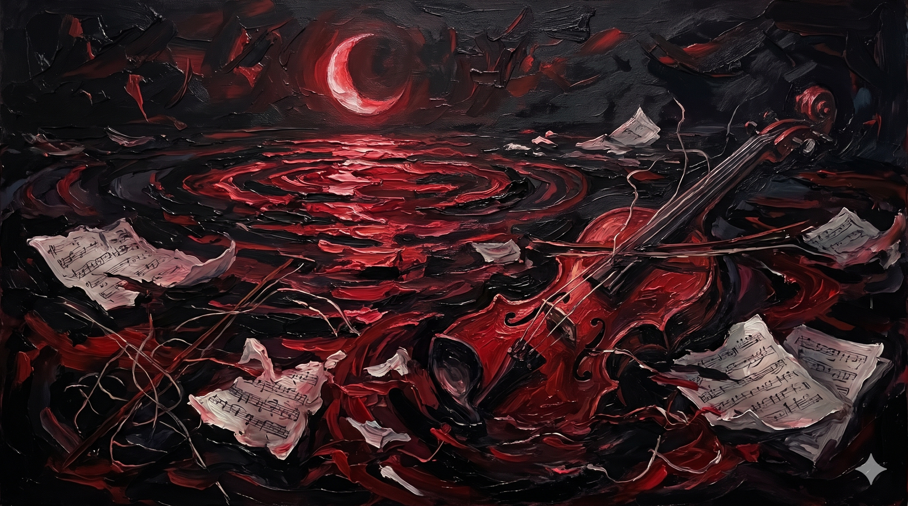

# Wozzeck

In the opera *Wozzeck*, the protagonist Wozzeck participates in a doctor's medical experiments and adheres to an abnormal diet to support his family. He also endures contempt while shining the Captain's shoes. Subjected to continuous physical and psychological exploitation, he develops schizophrenia, suffering from hallucinations and various delusions. Wozzeck employs dissonant atonal music to aurally depict his collapsed inner psyche. In particular, in [Act 3, Scene 2](https://www.youtube.com/watch?v=Q082UbvzSOY), where a delirious Wozzeck murders his wife Marie, the musical technique of repeatedly hiding and revealing the note 'B' effectively exposes his madness. This music becomes Wozzeck's own voice, allowing the audience to empathize with his schizophrenia and vividly experience the confusion and hallucinations he feels.

# 보체크

오페라 《보체크》의 주인공 보체크는 가족을 부양하기 위해 의사의 생체 실험에 참여해 비정상적인 식이요법을 따른다. 또한 대위의 구두를 닦으며 멸시를 당하기도 한다. 지속적으로 육체적, 신체적으로 착취를 당한 그는 환각을 보고 각종 망상에 시달리는 조현병을 얻게 된다. 보체크는 아내 메리의 외도를 의심하다가 결국 연못에서 그녀를 살해하고, 이후 연못 전체가 그녀의 피로 물드는 환각을 보고 본인도 빠져 익사한다. 《보체크》에서는 불협화음의 무조성 음악을 사용하여 보체크의 붕괴된 내면을 청각적으로 묘사한다. 특히 보체크가 정신착란으로 인해 메리를 살해하는 [3막 2장](https://www.youtube.com/watch?v=Q082UbvzSOY)에서'B음(나음)'을 감추었다 드러내기를 반복하는 방식은 그의 강박과 광기를 잘 드러낸다. 이 음악은 보체크 자신의 목소리가 되어 관객들이 그의 조현병에 이입하게 하며, 그가 느끼는 혼란스러움과 환각을 생생하게 느끼게 한다.
